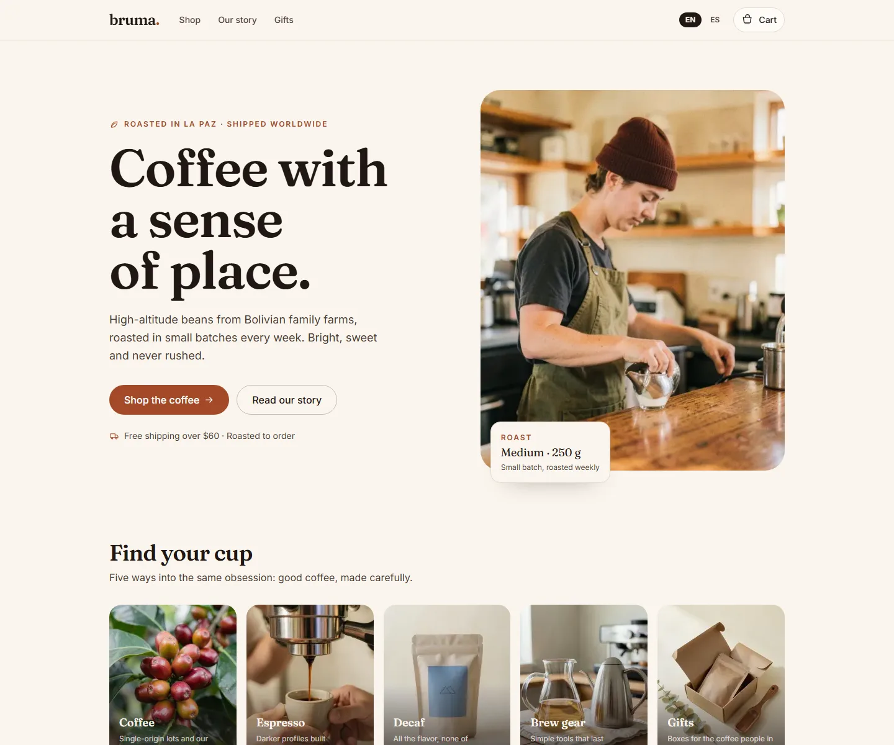

# Bruma Café

A bilingual storefront for a small-batch Bolivian coffee roaster, built as an original implementation with no page templates or copied assets.



## What it is

Bruma is a complete front-end storefront: home, catalog with categories, product pages, a persistent cart, a simulated checkout, order confirmation and legal pages, in English and Spanish.

It is a demo, not a shop. There is no payment provider, backend, inventory or email service: checkout validates the form with Zod and produces an order reference locally, and no card data is collected or stored.

## Why this over a store template

- **Clean-room build.** Layout, copy, palette and artwork were written for this project; no page template, copied class names or stock assets.
- **Bilingual by default.** `/[locale]` routes, typed dictionaries, automatic browser-language detection, a manual switcher, localized prices and dates, and `hreflang` alternates.
- **Market rules in one file.** Currency, formatting, flat shipping, the free-shipping threshold and the coupon live in `src/config/region.ts`.
- **No remote media.** All 16 product and editorial images are local WebP files generated for the brand, so the page makes no third-party image requests.
- **Small dependency surface.** Next.js, React, Tailwind CSS and Zod. No UI kit, no cart library, no state manager.

## Quick start

Requirements: Node.js 24 (see `.nvmrc`) and pnpm 11.

```bash
git clone https://github.com/JORDANROBERTO74/bruma-cafe.git
cd bruma-cafe
pnpm install
pnpm dev
```

Open <http://localhost:3000>. The proxy redirects to `/en` or `/es` based on your browser's `Accept-Language` and remembers an explicit choice in a cookie.

| Command | What it does |
| --- | --- |
| `pnpm dev` | Start the development server on port 3000 |
| `pnpm build` | Create an optimized production build |
| `pnpm start` | Serve the production build |
| `pnpm lint` | Run ESLint |
| `pnpm typecheck` | Run `tsc --noEmit` |

## Internationalization

Copy lives in `src/i18n/dictionaries/en.ts` and `es.ts`. The English file defines the `Dictionary` type, so a missing or misspelled key in Spanish fails `pnpm typecheck` instead of rendering a blank label.

- `src/i18n/config.ts` lists the supported locales and the default (`en`).
- `src/proxy.ts` detects the locale and redirects `/` to `/{locale}`.
- `src/lib/format.ts` centralizes `Intl` formatting for prices, dates and percentages.
- Every page declares canonical and `hreflang` alternates from `src/lib/seo.ts`.

## Region and currency

All market rules live in `src/config/region.ts`:

```ts
export const region = {
  id: "us",
  currency: "USD",
  locale: "en-US",
  shippingFlat: 600, // $6.00 in minor units
  freeShippingThreshold: 6000, // free over $60
  coupon: { code: "BRUMA10", percent: 10 },
} as const;
```

Prices are stored in minor units. Change those values and the store relocates: formatting, discounts and shipping follow. The coupon field on the cart accepts `BRUMA10` for 10% off.

## Cart and checkout

- Cart state is a reducer persisted to `localStorage` (`bruma.cart.v1`).
- Totals, discount and shipping are pure functions in `src/lib/cart.ts`.
- Checkout validates with Zod and is intentionally simulated: no payment provider is called and no card data is stored.
- The order is kept in `sessionStorage` (`bruma.order.v1`) only to render the confirmation page.
- The newsletter form is client-side only and does not submit anywhere.

## Artwork

`public/images/*.webp` are AI-generated photographs produced with `flux-2-klein-4b` through the local `image-forge` tool. The hero and product shots use a 4:5 frame at 1024 px wide; category tiles are square. Every scene was produced with image-to-image, keeps the cream, terracotta and olive palette of the brand, and carries no lettering or logos.

## Project structure

```text
src/
  app/[locale]/          routes: home, menu, product, cart, checkout, order, legal
  components/            layout, home, product, cart, checkout, ui primitives
  config/                site identity and region/currency settings
  data/                  product catalog and categories
  i18n/                  locale config, dictionaries and loader
  lib/                   cart reducer, totals, formatting, SEO, order helpers
  providers/             cart context with localStorage persistence
  types/                 shared domain types
docs/
  screenshot.webp
```

## Deployment

The app uses the default Vercel Next.js preset; no `vercel.json` is required.

1. Import the repository and keep the detected settings (`pnpm install`, `pnpm build`, output `.next`).
2. Set `NEXT_PUBLIC_SITE_URL` to the production origin.
3. Deploy, then verify `/{en,es}`, `/sitemap.xml`, `/robots.txt`, the Open Graph images and a full checkout run.

`NEXT_PUBLIC_SITE_URL` drives canonical links, `hreflang`, `sitemap.xml`, `robots.txt` and Open Graph URLs. When it is unset, the code falls back to `https://brumacafe.com`; the public demo sets it to its Vercel origin.

Live demo: <https://bruma-cafe-gamma.vercel.app>

## Status and scope

This is a portfolio reference implementation, maintained but not production-ready for real orders. There is no persistence beyond the browser, no authentication and no payment integration. Verification covers `pnpm lint`, `pnpm typecheck`, `pnpm build` and a manual checkout pass in both locales at desktop and mobile widths.

## License

Proprietary, all rights reserved. See [LICENSE](LICENSE). Third-party dependencies remain under their own licenses.
